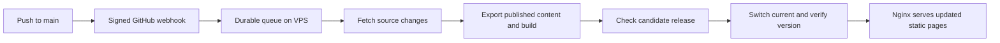

# Incremental VPS deployment plan

Status: proposed implementation, 2026-10-12 (Asia/Shanghai). This document
records Morii's request for automatic updates after a push, with a normal
push-to-visible target of three minutes and a maximum of five minutes. The
receiver, worker, repository settings, and release changes described below
are not implemented or enabled by this document.

## Current evidence

Read-only checks on 2026-10-12 established these facts:

| Surface | Observed state |
| --- | --- |
| Local `main` | `fd48f88c8b480480fd48a8efe36ef400b3be99b8` |
| GitHub `main`, checked from Windows and the VPS | `3aee39629476cad3806d8ad70e15fde53d511782` |
| Local commit absent from GitHub `main` | `fd48f88`, “Refresh About activity snapshot for September 30” |
| Existing working-tree backlog | Five modified tracked files and six untracked files, listed below |
| VPS `current` | `/var/www/moriium/releases/fd48f88c8b480480fd48a8efe36ef400b3be99b8` |
| Public availability | `https://morii9961.top/zh/` returned HTTP 200 |
| Author service | `moriium-admin.service` was active |
| VPS tools | Node 24.15.0, pnpm 11.22.0, Git 2.43.0, rsync 3.2.7, Astro 7.2.4 |
| VPS resources | Two CPU cores; approximately 3.6 GiB RAM |
| Existing source workspace | Extracted archive, without `.git` |
| Allocated sizes reported by `du -sh` | `dist`: 32 MiB; `node_modules`: 509 MiB; releases: 31 MiB |
| Build caches | `.astro`: 36 KiB; `node_modules/.astro`: 16 KiB |
| Repository visibility | Public, confirmed through the GitHub connector |

The existing modifications are `deploy/bin/deploy-code.sh`,
`deploy/nginx/moriium.conf`, `deploy/systemd/moriium-admin.service`,
`enouia/README.md`, and `tests/deployment-contract.test.mjs`. The untracked
files are the two October 5 deployment handoffs, the three files under
`docs/status/`, and `enouia/deploy/nginx.conf`. They predate this plan and must
be preserved and reviewed separately. About activity data was not refreshed:
Morii requested that refresh only if there was no backlog.

The current workflow already uploads source and builds beside the VPS
database, as required by ADR 0002 sections 15.2–15.3. It verifies both sites,
creates a complete source archive, uploads it, and invokes `deploy-code.sh`
when `DEPLOY_ENABLED=true`. The driver replaces the workspace, reuses
dependencies when the lockfile matches, stops Admin during the build, and
invokes the static release state machine. The automation flag and webhook
configuration were not inspected in this investigation.

`package.json` runs `astro build --force`. No incremental-build flag or page
cache keys are configured. The installed Astro types and build implementation
on the VPS contain `experimental.incrementalBuild` and `cacheKey` support.
Removing `--force` alone does not make the site an incremental build.

The historical deployment runbook and ADR describe the relevant production
contract. `docs/architecture.md` still contains an older description without
Admin or a database; it must be reconciled when this feature is implemented.
Historical timings in the ADR are not a current performance benchmark.

## Recommended path

Use a signed GitHub repository webhook to wake a small VPS deployment
controller. Keep a persistent Git object store and build workspace on the
VPS. Fetch changed source, reuse validated build caches, create a new immutable
release from changed output, and switch the public symlink after checks.

This removes archive upload and Actions artifact transfer from deployment.
Production content stays in the VPS database. Public pages and search remain
static. The controller is deployment infrastructure under the existing
author/internal-API scope; it must not become a reader service.

Retain GitHub-hosted verification for PRs. The current public repository's
standard hosted runner minutes are free under
[GitHub's current billing rules](https://docs.github.com/en/billing/concepts/product-billing/github-actions).
Artifact storage, cache storage, and larger runners have separate rules. The
older Twilight repository's exhausted allowance has not been investigated.
There is no need to remove useful verification merely to avoid uploading the
site through Actions.

## Triggering and verification

Expose one exact HTTPS endpoint, proposed as `/api/deploy-hook/`, through
Nginx to a separate loopback receiver. It must remain available while Admin
restarts. The receiver only authenticates and writes deployment intent; a
systemd worker executes fixed operations independently of HTTP requests.

Validate HMAC-SHA256 over the original request bytes, using a constant-time
comparison. Pin the repository identity and `refs/heads/main`, ignore branch
deletion, bound the request body, and validate commit IDs. Keep the webhook
secret outside the repository. These requirements follow
[GitHub's delivery validation contract](https://docs.github.com/en/webhooks/using-webhooks/validating-webhook-deliveries).

Persist intent before returning 202, targeting a response below one second.
Deduplicate delivery IDs, while allowing an explicit retry of a failed job.
GitHub expects a response within ten seconds, recommends asynchronous
processing, and reuses the delivery ID for redelivery; see
[webhook best practices](https://docs.github.com/en/webhooks/using-webhooks/best-practices-for-using-webhooks).
The receiver must not run repository scripts or accept a shell command from
the payload. A valid signature authenticates the notification, not arbitrary
code execution authority.

Preserve full verification as a release gate:

- Protect `main` and require the existing full verification before merge.
- Authorize deployment only with successful evidence for the exact candidate
  SHA, or a recorded equivalence between its Git tree and the fully verified
  merge candidate. A successful check on an unrelated or older SHA is invalid.
- If equivalent evidence is unavailable for a direct push, run `pnpm verify`
  in an isolated VPS workspace with synthetic data before production export.
  Its time counts toward the five-minute requirement.
- Shared rendering, dependency, authentication, and persistence changes keep
  their full integration gates. Never replace them with a homepage-only probe
  to meet a timing target.

Whether to use protected merges or isolated VPS verification is an activation
decision. The initial recommendation is protected, verified merges, so the
push-to-live path does not repeat the PR's full verification. Do not deploy
immediately from the webhook while its verification is still pending.

## Three forms of incremental work

### Source transfer

Bootstrap a persistent repository once. Subsequent releases use a bounded
fetch of the fixed `main` ref into that object store and select a fetched SHA;
never reclone or download a fresh archive for each push. Git fetch negotiates
objects already present, rather than uploading the complete site output. See
the installed version's [Git fetch reference](https://git-scm.com/docs/git-fetch/2.43.0).

Materialize the selected tree in an owned build checkout. Apply changes and
deletions only to tracked source; preserve dependency and build caches. Do not
use `git clean -fdx`, which could erase ignored build inputs. Keep database
exports and generated media under the existing explicitly owned directories,
and keep all persistent author data outside the checkout. Never fetch a URL
supplied by a webhook. Private-repository access, if needed later, uses a
read-only repository credential.

### Build work

Keep dependencies keyed by the lockfile, package manifest, Node/pnpm versions,
platform, and install configuration. Lockfile equality alone does not cover
all environment changes. Retain content, image, and metadata caches across
builds, with explicit invalidation when their inputs change.

Astro 7.2 introduced experimental static page reuse via
`experimental.incrementalBuild` and `getStaticPaths()` cache keys. Only keyed
pages qualify. Its cache lives in `cacheDir`, normally `node_modules/.astro`;
`--force` bypasses reuse. Middleware changes need explicit invalidation, and
build concurrency above one disables reuse. Configuration/dependency changes
invalidate pages. See the
[Astro incremental-build contract](https://docs.astro.build/en/reference/experimental-flags/incremental-build/).

Enable this feature only after testing it against clean builds on the pinned
7.2.4 version. Keep a force-build recovery mode. Incremental rendering still
runs bundling and aggregate generation; its presence does not make all build
work proportional to the number of edited articles.

The article route reads more than the article itself: translations, adjacent
articles, and available categories/tags all affect its output. Its cache key
must include those data dependencies and media/metadata inputs that are read
dynamically. A post digest alone is insufficient. Related-list changes must
invalidate affected neighboring pages. Any data dependency not yet modeled
forces a conservative rerender.

Initially rebuild the small aggregate surfaces on every build: home, archive,
category/tag listings, RSS, sitemap, search indexes, and About. This keeps
translation availability, removed posts, ordering, and usage snapshots fresh.
Add finer aggregate keys only when measurements justify the complexity.

Preserve sanitized media whose content hashes are unchanged. Avoid deleting
and recopying the entire media projection on each export. Process new images
before accepting them as publishable content, so bulk image conversion does
not unexpectedly enter an ordinary deployment. Original photos never enter
the worker's publishable input.

### Release output

Create a fresh staging directory on the VPS. Reuse byte-identical files from
the previous release with hard links, and write changed files separately.
`rsync --link-dest` supports this pattern; see the
[rsync manual](https://rsync.samba.org/ftp/rsync/rsync.1).
Use content comparison or a validated digest manifest: fresh build mtimes can
otherwise make unchanged files look changed. Comparison still scans files and
consumes local disk time, which belongs in the benchmark.

Require the same filesystem for hard-link reuse. Never write in place, alter
shared inodes after linking, or run synchronization against `current`. A fresh
snapshot naturally excludes files removed from the new build. Keep six
releases as today, with guarded cleanup after successful publication.

Retaining old release directories alone does not make an old asset URL
reachable through Nginx's `current` root. Keep content-addressed `_astro` and
media assets in a shared, append-only public asset pool; retain referenced
objects for the retained releases plus a defined grace period. Preserve cache
headers for hashed assets. HTML, extensionless page URLs, and unhashed mutable
assets must revalidate, so a successful switch appears in a normal browser
without requiring a hard refresh. Removed article HTML must remain removed;
asset retention must not expose it through a fallback.

## Release consistency and failure handling

Separate the mutable build workspace from the running Admin build. Build and
check a candidate while the old public release and Admin runtime remain
available. Retain each runtime's compatible dependencies; do not mutate a
dependency directory shared with a running old runtime.

Reuse the existing release state machine's export, public-tree, link, render
split, atomic switch, and live-version ordering. Extend it with coordinated
public/runtime activation and rollback. One deployment lock serializes code
and content publication. Queue database publish events through the same worker
when that author trigger is implemented.

Identify a release by code SHA, exported content snapshot, and build-input
fingerprint. A code SHA alone cannot identify two different database content
exports. Mark only versions present in that snapshot as live; a publication
during a build schedules the next release and remains visibly pending.

Probe a candidate Admin runtime on an isolated loopback port, then restart the
production service only for the short activation interval. Candidate checks
use synthetic data unless real-data access is explicitly part of the approved
release. Freeze publication briefly for coherent export if a transactional
snapshot cannot be obtained. Database migrations require a separate compatible
migration procedure; automatic code rollback must never pretend to undo a
forward database migration.

Write a public, non-sensitive version marker into each release. After switching,
check the expected marker over the formal hostname with cache revalidation,
three-language routes, representative changed content, RSS, sitemap, search,
and Admin readiness. HTTP 200 alone cannot distinguish an old page from the
new release. Record live versions only after the checks establish the expected
release. Probe failure restores both previous public selection and previous
compatible runtime, and preserves diagnostic evidence.

The worker must handle failures, termination, reboot, and retries as explicit
states. On restart it reconciles any incomplete switch before accepting more
work. Existing `on_error` handling covers ERR, not a complete durable recovery
protocol; it must not be assumed sufficient for timeout or shutdown recovery.

## Repeated pushes and missed notifications

Maintain durable desired/running/live/failed release states. Coalesce queued
updates to the newest authorized `main` version. Record superseded commits as
such; do not promise that every intermediate commit becomes briefly visible.
This avoids a long FIFO backlog after several quick pushes.

Before activation, reconcile the candidate with the fetched `main` head and its
verification evidence. If a newer authorized candidate exists, do not allow an
older queued notification to publish over it. Bound retries and cancellation;
stop obsolete preparation only at a safe point. Once activation starts,
complete it or roll it back before starting another job. A final push in a
burst must receive a fresh elapsed-time measurement including any remaining
queue wait; burst tests are mandatory for the five-minute target.

Add a one-minute reconciliation timer to recover a missed webhook, with bounded
network timeouts and backoff. It rechecks the fixed GitHub ref and enqueues
only new eligible work. Failures are recorded for the author; no unsolicited
email or chat notification integration is included. Never claim a failed or
superseded commit is live.

Route work by changed paths: Enouia has its own build, output, virtual host,
release root, and rollback. An Enouia-only change must not rebuild Moriium.
Shared tooling changes can affect both; unknown paths classify conservatively.
Documentation-only changes may finish with verification and a recorded no-op.
The first implementation targets the Moriium main site; activating an Enouia
worker is a separate rollout.

## Timing contract and acceptance

Measure from GitHub's acceptance of a push to a fresh HTTPS response proving
the expected code/content release. Include notification, verification wait,
queue wait, network time, build, checks, activation, and browser cache policy.
Warm local build duration alone is not this metric.

The following figures are design budgets, not measured predictions:

| Step | Three-minute budget |
| --- | ---: |
| Notification and queue | 10 s |
| Incremental fetch and source preparation | 20 s |
| Content export and cache/dependency decisions | 20 s |
| Build | 90 s |
| Candidate checks and release materialization | 25 s |
| Activation and formal-host version probes | 15 s |
| Total | 180 s |

Reserve the remaining 120 seconds for bounded variation and recovery. Enforce
one end-to-end deadline across subprocesses rather than separate five-minute
timeouts per command. A deadline failure keeps or restores the previous release
and reports failure. That proves bounded failure handling, not successful
publication within five minutes.

An unconditional successful five-minute guarantee is impossible for arbitrary
new media volume, dependency downloads, unavailable GitHub, or unlimited push
bursts. Establish a measured workload envelope: maximum new bytes, image
conversion work, route count, cold-cache cost, and push frequency. Large imports
must be prepared ahead of the ordinary deployment. If even prepared updates
exceed the limit, improve the measured bottleneck or add an isolated builder;
do not silently weaken verification.

Acceptance requires an isolated Linux instance before production activation:

1. Benchmark unchanged rebuilds, About data edits, one article edit, addition,
   removal, translation changes, adjacent links, new sanitized images, shared
   layouts, dependencies, cold caches, and simultaneous pushes. Compare warm
   incremental output with a clean build for correctness.
2. Record transferred bytes, cache hits, rendered pages, per-stage durations,
   queue wait, total time, release IDs, and failure stage. Run at least 20
   representative warm updates; target p95 at or below 180 s, with every
   supported scenario at or below 300 s. Keep failures visible in the results.
3. Verify HMAC failures, duplicate/out-of-order deliveries, crash recovery,
   lock contention, export/build/probe failure, cancellation, and rollback.
   Ensure no private source, secrets, or original media enter public output.
4. Prove Nginx continues serving all public routes after stopping Node in the
   isolated instance, and that old open pages still resolve retained hashed
   assets after a switch.
5. Measure a complete production push only after authorized activation. Local
   or isolated results do not establish the production SLA.

## Implementation order

1. Review and reconcile the existing local backlog with GitHub and the deployed
   fixes. Commit/push only when Morii requests those operations.
2. Add timings and correctness fixtures, then establish an isolated baseline.
3. Implement source fetching, cache reuse, incremental page keys, and immutable
   output reuse. Keep the existing deployment path available for recovery.
4. Implement the receiver, durable coalescing worker, version probes, compatible
   runtime switching, and recovery; run the integration and failure suite.
5. Update the deployment runbook and stale architecture description for the
   implemented contract. Configure protected verification, the webhook, and
   systemd units during an explicitly authorized activation.
6. Pass timed end-to-end acceptance before describing automatic deployment or
   the three-to-five-minute target as operational.

This investigation performed read-only GitHub/VPS checks and added this local
plan. It did not refresh activity data, commit, push, install services, create
webhooks, change repository settings, deploy, or stop production Node. No build
or deployment benchmark was run.
